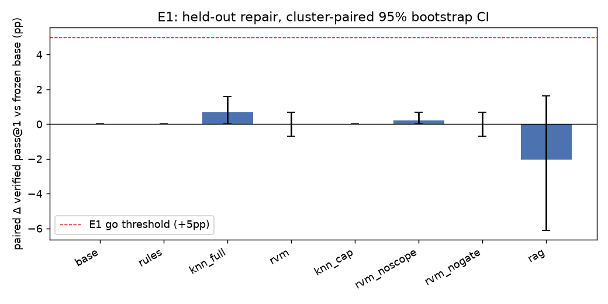
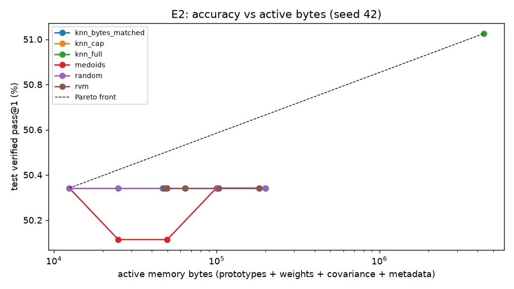
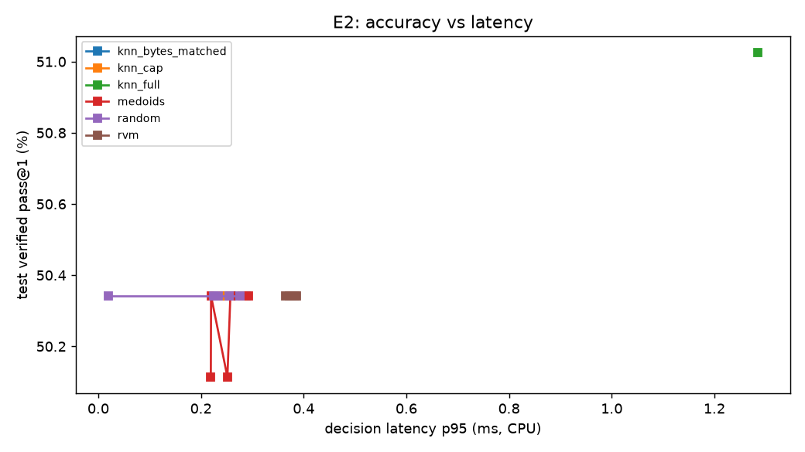
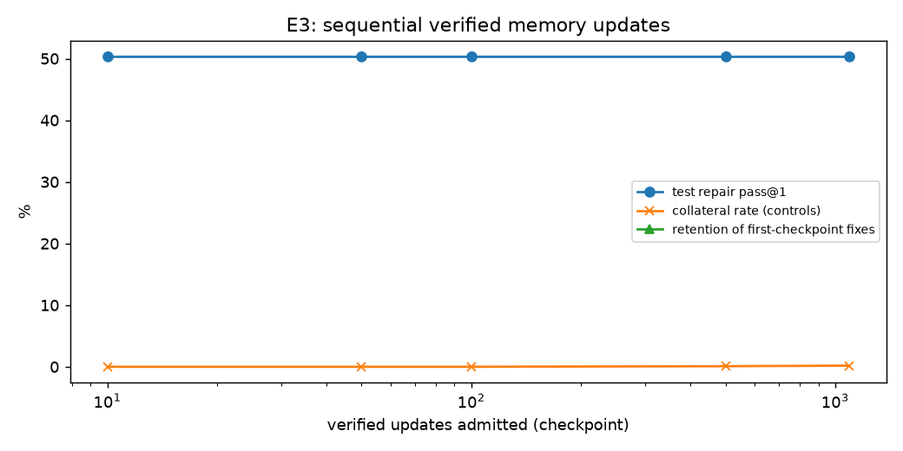
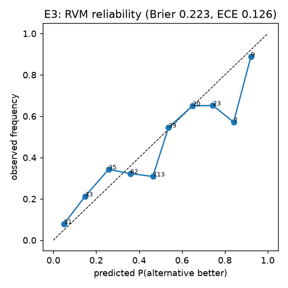
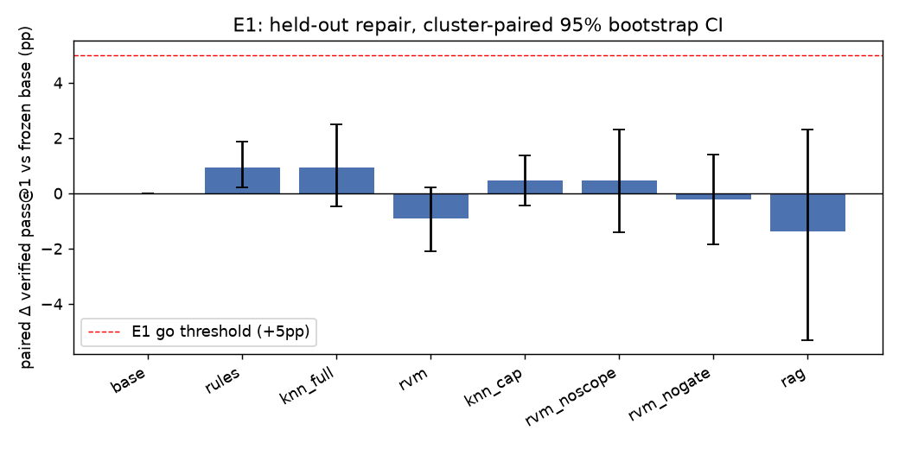
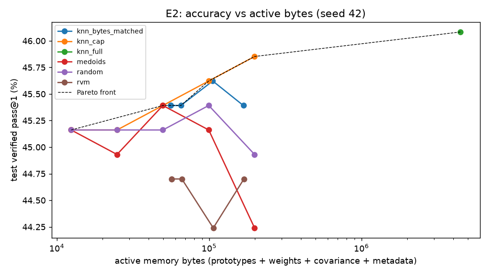

# SPaRCE PoC — final research report

**Author:** coding agent (Claude Fable 5.1)  
**Date:** 2026-10-17  
**Repository commit:** `4bfb0791d8128c4daab66d8ce1f34c5fb18b5c9a` (dirty=False)  
**MLflow experiment:** `sparce-poc` at `http://127.0.0.1:5000` (SSH-tunnelled; loopback only); run IDs: E1-verified-repair=`cb6adf6f0d7849a49dd5152a0b6b9bf7`, E2-sparse-pareto=`4b3c32156c394fcfb96c8aff19429c1d`, E3-safety-stream-rollback=`be92c33c78cd4e2caa7fc339165f6831`  
**Overall decision:** **NO-GO** — E1 NO-GO, E2 NO-GO, E3 INCONCLUSIVE (details in §9)

## 1. Executive summary

We built an executable, version-pinned Python API-change repair benchmark (3148 tasks, 572 program clusters, 71 API families, 18 pinned Docker environments) from first-party programs, because CodeSyncBench ships no executable tests and no license (§3). A frozen Qwen2.5-Coder-3B-Instruct generates K=4 candidates per task; every candidate is executed against hidden tests in a network-disabled, non-root container. SPaRCE (scoped Laplace-ARD pairwise RVM with support and credible-margin gates) reranks the K candidates.

- **E1 (held-out verified repair):** SPaRCE pass@1 50.3% vs frozen base 50.3% on N=439 test repairs (224 clusters); paired Δ +0.0 [-0.7, +0.7] pp (cluster bootstrap 95% CI). Candidate recall@K = 63.3% (reranking ceiling). Strongest comparator: knn_full at 51.0%. Decision: **NO-GO**.
- **E2 (sparse Pareto):** count-matched improvement at capacities [], bytes-matched []; RVM non-dominated: False; compression target met at capacities [8, 16, 32, 64, 128] (full-kNN 51.0% at 4374342 bytes). Decision: **NO-GO**.
- **E3 (safety):** collateral regressions 1/1220 = 0.08% (one-sided Wilson 95% upper 0.37%, cluster-bootstrap upper 0.25%); retention loss at 100 updates n/a pp; rollback exact: True; false submissions admitted: 0/20. Decision: **INCONCLUSIVE**.
- What cannot be concluded: see §7 (power) and §9 (limitations). All thresholds were fixed in docs/EXPERIMENT_PROTOCOL.md v0.2 before test evaluation.

## 2. Reproducibility manifest

| Item | Value |
| --- | --- |
| Frozen LLM | `Qwen/Qwen2.5-Coder-3B-Instruct` @ `488639f1ff808d1d3d0ba301aef8c11461451ec5` (float16, 3085938688 params) |
| Embedding | `sentence-transformers/all-MiniLM-L6-v2` @ `1110a243fdf4706b3f48f1d95db1a4f5529b4d41` (dim 384) |
| GPU / driver | NVIDIA RTX A4000, 595.71.05, 16376 MiB |
| torch / CUDA | 2.14.1+cu130 / 13.0 (cuda_available=True) |
| Python / uv.lock | 3.11.17 / `sha256:ae89dbc4e0ebe7b5835aefefb53dda10a0837c702b8b1d97701599afbc418eb6` |
| Git commit | `4bfb0791d8128c4daab66d8ce1f34c5fb18b5c9a` |
| Benchmark | first-party executable catalog (MIT), 3148 tasks; tasks.jsonl `sha256:11c85ae7e2d1ef15579f64f39c1decc9520ab556f91357f6d171c9d698cc0aa2`; hidden.jsonl `sha256:ba0aa38be5af1f70f50daf958b5e4d4eae26157553cb12c8a6da9654b1f2f56b` |
| Split policy | chronological by simulated stream timestamp at cluster level (train 0.45, val 0.15), 0.2 of API families held out entirely |
| Leakage audit | {"clusters_straddling_splits": [], "heldout_family_outside_test": [], "train_max_timestamp": "2023-12-05T06:19:31.964485+00:00", "known_family_test_min_timestamp": "2024-05-31T11:11:00.702467+00:00", "chronology_ok": true, "exact_duplicate_request_groups": 0, "ok": true} |
| Environments | 18 docker images: `py3.11-numpy-2.1.3-415ac50f79`=sha256:119bc51ed471; `py3.11-numpy-1.26.4-c5d65304d5`=sha256:9ab8d52c3f9a; `py3.11-numpy-1.26.4-3729b84097`=sha256:80d9be237b05; `py3.11-numpy-1.26.4-cdfb5a3327`=sha256:aba8c91202fe; `py3.11-numpy-1.26.4-d8f25c837b`=sha256:2160577c9ee7; `py3.11-numpy-1.26.4-2012c2102d`=sha256:a3c19fbe2bac; `py3.11-numpy-1.26.4-a113e77f88`=sha256:1b63e21e4112; `py3.11-numpy-1.26.4-1b148fa841`=sha256:c5bebd26adf5; `py3.11-pillow-10.4.0-b7ed81f07c`=sha256:331d2b1d4c4a; `py3.11-pillow-9.5.0-ccc8f476ca`=sha256:232b419b63f9; `py3.11-networkx-3.3-d323e040e9`=sha256:db021c74a2b9; `py3.11-networkx-2.8.8-be78d257d3`=sha256:eb76eb6789fc; `py3.11-jinja2-3.1.4-d193e0ca9a`=sha256:b97fcc0473c6; `py3.11-jinja2-2.11.3-d08b08374b`=sha256:4e948352d3e2; `py3.11-pydantic-2.9.2-fee796cda9`=sha256:07a731e8bb04; `py3.11-pydantic-1.10.18-be312fee7f`=sha256:65626debe250; `py3.13-stdlib-52c0bba2ba`=sha256:7284969b27de; `py3.11-stdlib-ade24754fc`=sha256:75c2e9d44236 |
| Verifier | docker, `--network none`, uid 65534, read-only rootfs, 2048 MB, 128 pids, 30 s/job |
| Generation budget | K=4 (greedy + sampled T=0.8), max_new_tokens=384, max_input=2048, batch=12 |
| Seeds | [42, 1337, 2026] |
| Peak VRAM (generation) | 9.81 GB reserved |
| Stages | {"prepare": "2026-10-17T09:58:02Z", "generate": "2026-10-17T12:22:28Z", "verify": "2026-10-17T12:38:51Z", "embed": "2026-10-17T12:39:03Z"} |
| Work dir / logs | `runs/full1` (suite.log, cache/, results/) |

Setup and run commands:

```bash
uv sync --group dev --extra gpu
bash scripts/start_mlflow.sh
uv run sparce run-suite --config configs/a4000.toml            # full suite
uv run sparce run-suite --config configs/a4000.toml --resume   # continue an interrupted run
uv run sparce summarize --config configs/a4000.toml            # regenerate report/plots from caches
```

## 3. Methodology

**Benchmark.** CodeSyncBench (HF `LuckyVoyage/CodeSyncBench`) was assessed on 2026-10-17: no dataset card, no license, static QA/completion records only (`API_path`, `question`, `answer`, signatures), no executable tests. It was therefore not used. Instead a first-party catalog of 18-environment, real, documented breaking changes (numpy 2.0, pandas 2.0, SciPy 1.12–1.15, scikit-learn 1.2–1.6, Pillow 10, networkx 3, Jinja 3, pydantic 2, CPython 3.12/3.13 removals) was authored, each with 6–8 distinct programs and 2 unchanged-sibling controls, and validated by execution (old code passes on the legacy pin, fails on the new pin; reference fix passes). Execution validation excluded 100 of 3148 generated tasks (catalog_validation.json). Variant 1 of each program applies consistent identifier renaming (tokenize-based) and shares the program's cluster id.

**Task kinds.** repair (old code on the new pin; the real traceback is shown), previously_correct (reference code on the new pin), old_version (old code on the legacy pin; out of memory scope), near_api / near_api_old (sibling programs using related unchanged APIs). Counts: {"near_api": 277, "near_api_old": 277, "old_version": 832, "previously_correct": 831, "repair": 831}. Repair split sizes {"train": 296, "val": 96, "test": 439}; test subsets {"known_family": 272, "heldout_family": 167}.

**Candidates and base score.** Candidate 0 = greedy, candidate 1 = nucleus sample (fixed task-derived seed); the assistant turn is prefilled with a code fence for every method. Base score = mean per-token log-likelihood of the response under the frozen model; the frozen base picks the higher score (ties → greedy). All rerankers see the same two candidates, the same score margin d0, and the same joint embedding (scope + error headline + unified diff request→candidate; MiniLM-L6-v2). Hidden tests and reference fixes never enter prompts, retrieval, embeddings or ranking.

**SPaRCE.** Per exact scope (package==version) a Laplace-ARD pairwise RVM: P(a≻b)=σ(d0+Σ_j w_j[k(q_a,z_j)−k(q_b,z_j)]), Gaussian ARD priors α_j, MAP + Laplace covariance, farthest-first pre-screen to max_basis, then ARD pruning (α>1e6). Gate: exact scope → support (max kernel to a retained vector ≥ min_support) → credible margin (mean − z·sd > threshold). Prototypes are verified candidate embeddings (pass → +, fail → −) from training events; pairs with one passing and one failing candidate supply labels. Hyperparameters tuned on validation only: {"length_scale": 0.6, "min_support": 0.65, "z_score": 1.0, "margin_threshold": 0.0}; kNN: {"k": 1, "threshold": 0.0, "min_support": 0.8}.

**Comparators.** B0 frozen base (K=1 greedy and K=2 score pick); B1 rules = exact-scope identifier substitution rules mined from verified training repairs; B2 RAG = prompt augmented with entries retrieved from the pinned package's own public API inventory (dumped inside the sandbox; generator baseline with its own candidates and larger token cost); B3 full kNN (similarity-weighted vote of verified neighbours, same scope gate); B4 kNN at the RVM's active count; B5 random prototypes; B6 k-means medoids; B7 RVM without scope; B8 RVM without credible gate; B9 SPaRCE. Verifier-assisted selection (run both candidates) equals recall@K and is reported separately as an upper bound.

**Deviations from the protocol.** (1) CodeSyncBench replaced by a first-party executable catalog (license/executability). (2) Stream timestamps are simulated (exponential offsets after the real release date, deterministic per cluster) because first-party programs have no observation time. (3) max_new_tokens 384 instead of 256 (whole-module rewrites), identical for all methods. (4) Seeds vary memory fitting/selection and bootstrap only; candidate generation is produced once per task with a fixed task-derived seed (GPU budget). (5) SERAC/GRACE/WISE/MEMOIR were not run (out of the 16 GB / 9 h budget). Recorded before test evaluation in docs/EXPERIMENT_PROTOCOL.md v0.2.

## 4. E1 — Verified error repair

**Memory coverage of the test split.** Families with at least one training repair: None of 71; test repairs in such families ("seen_family"): None vs unseen None (nominal split labels were known=None, heldout=None). Headroom tasks (base wrong, some candidate passes): None overall, None in seen families. Base pass@1 by package: {}; test repairs by package {}.

Test repairs N=439 (224 clusters); train events 1092 (708 with a pairwise label); val 335. Greedy-only (K=1) pass@1 = 50.3%; candidate recall@K = 63.3% (known families 56.6%, held-out families 74.3%). Reranking cannot exceed recall@K.

| Method | N | pass@1 % | paired Δ vs base pp [95% CI] | known-fam % | held-out-fam % | fixes / regressions | activations | tokens/task | p95 decision ms | control regressions |
| --- | ---: | ---: | ---: | ---: | ---: | ---: | ---: | ---: | ---: | ---: |
| base | 439 | 50.3 | +0.0 [+0.0, +0.0] | n/a | n/a | 0 / 0 | 0 | 1252 | 0.00 | 0 |
| rules | 439 | 50.3 | +0.0 [+0.0, +0.0] | n/a | n/a | 0 / 0 | 4 | 1252 | 0.06 | 0 |
| knn_full | 439 | 51.0 | +0.7 [+0.0, +1.6] | n/a | n/a | 3 / 0 | 8 | 1252 | 1.11 | 3 |
| rvm | 439 | 50.3 | +0.0 [-0.7, +0.7] | n/a | n/a | 1 / 1 | 4 | 1252 | 0.37 | 1 |
| knn_cap | 439 | 50.3 | +0.0 [+0.0, +0.0] | n/a | n/a | 0 / 0 | 0 | 1252 | 0.26 | 0 |
| rvm_noscope | 439 | 50.6 | +0.2 [+0.0, +0.7] | n/a | n/a | 1 / 0 | 3 | 1252 | 0.46 | 0 |
| rvm_nogate | 439 | 50.3 | +0.0 [-0.7, +0.7] | n/a | n/a | 1 / 1 | 4 | 1252 | 0.38 | 1 |
| rag | 439 | 48.3 | -2.1 [-6.1, +1.6] | n/a | n/a | 20 / 29 | 439 | 1778 | 0.01 | 45 |
| verifier-assisted (any of K passes) | 439 | 63.3 | — | 56.6 | 74.3 | — | — | — | +1559 ms verifier | — |

Seed sensitivity (mean ± sd of pass@1 over seeds [42, 1337, 2026]): base 50.3 ± 0.0; rules 50.3 ± 0.0; knn_full 51.0 ± 0.0; rvm 50.3 ± 0.0; knn_cap 50.3 ± 0.0; rvm_noscope 50.6 ± 0.0; rvm_nogate 50.3 ± 0.0; rag 48.3 ± 0.0.

E1 decision reasoning: N ≥ 200; gain +0.0 pp (CI low -0.7); margin vs strongest comparator (knn_full) -0.7 pp; checks {"n_ge_min": true, "gain_ge_5pp": false, "ci_lower_gt_0": false, "within_2pp_of_strongest_comparator": true} → **NO-GO**.

Decision reasons on test repairs (SPaRCE): {"insufficient_credible_gain": 6, "low_support": 713, "no_distinct_alternative": 131, "posterior_supported": 6, "scope_mismatch": 765}. Per-scope fit log: {"pandas==2.2.3": {"status": "fit", "n_pairs": 116, "n_pool": 548, "screened": 12, "active": 11}, "pandas==1.5.3": {"status": "fit", "n_pairs": 72, "n_pool": 338, "screened": 8, "active": 8}, "scikit-learn==1.6.1": {"status": "fit", "n_pairs": 54, "n_pool": 162, "screened": 4, "active": 4}, "scikit-learn==1.1.3": {"status": "fit", "n_pairs": 18, "n_pool": 85, "screened": 2, "active": 2}, "pillow==10.4.0": {"status": "fit", "n_pairs": 34, "n_pool": 146, "screened": 3, "active": 3}, "pillow==9.5.0": {"status": "fit", "n_pairs": 23, "n_pool": 90, "screened": 2, "active": 2}, "networkx==3.3": {"status": "fit", "n_pairs": 117, "n_pool": 392, "screened": 9, "active": 9}, "networkx==2.8.8": {"status": "fit", "n_pairs": 52, "n_pool": 225, "screened": 5, "active": 4}, "jinja2==3.1.4": {"status": "fit", "n_pairs": 55, "n_pool": 284, "screened": 6, "active": 5}, "jinja2==2.11.3": {"status": "fit", "n_pairs": 55, "n_pool": 207, "screened": 5, "active": 5}, "pydantic==2.9.2": {"status": "fit", "n_pairs": 61, "n_pool": 182, "screened": 4, "active": 3}, "pydantic==1.10.18": {"status": "fit", "n_pairs": 29, "n_pool": 89, "screened": 2, "active": 2}, "python==3.13": {"status": "fit", "n_pairs": 15, "n_pool": 46, "screened": 2, "active": 2}, "python==3.11": {"status": "fit", "n_pairs": 7, "n_pool": 19, "screened": 2, "active": 2}}



## 5. E2 — Accuracy versus sparse memory cost

Prototype pool 2813 verified candidate embeddings; capacities [8, 16, 32, 64, 128]; test repairs N=439; per-prototype kNN bytes 1555. Cold evidence store (raw texts + verifier records) = 2813323 bytes, reported separately.

| Method | capacity | active | bytes total | prototype bytes | covariance bytes | pass@1 % | Δ vs base pp [CI] | p50/p95 ms | fit s | control regr. |
| --- | ---: | ---: | ---: | ---: | ---: | ---: | ---: | ---: | ---: | ---: |
| knn_full | full | 2813 | 4374342 | 4320768 | 0 | 51.0 | — | 0.32/1.28 | 0.01 | 3 |
| rvm | 8 | 28 | 47998 | 43008 | 448 | 50.3 | +0.0 [-0.7, +0.7] | 0.01/0.37 | 0.15 | 1 |
| knn_cap | 8 | 8 | 12442 | 12288 | 0 | 50.3 | +0.0 [+0.0, +0.0] | 0.01/0.23 | 0.03 | 0 |
| random | 8 | 8 | 12436 | 12288 | 0 | 50.3 | +0.0 [+0.0, +0.0] | 0.01/0.02 | 0.02 | 0 |
| medoids | 8 | 8 | 12440 | 12288 | 0 | 50.3 | +0.0 [+0.0, +0.0] | 0.01/0.22 | 0.05 | 0 |
| knn_bytes_matched | 8 | 30 | 46650 | 46080 | 0 | 50.3 | — | 0.02/0.26 | 0.04 | 0 |
| rvm | 16 | 29 | 49590 | 44544 | 488 | 50.3 | +0.0 [-0.7, +0.7] | 0.00/0.38 | 0.16 | 1 |
| knn_cap | 16 | 16 | 24884 | 24576 | 0 | 50.3 | +0.0 [+0.0, +0.0] | 0.01/0.23 | 0.04 | 0 |
| random | 16 | 16 | 24873 | 24576 | 0 | 50.3 | +0.0 [+0.0, +0.0] | 0.01/0.22 | 0.03 | 0 |
| medoids | 16 | 16 | 24874 | 24576 | 0 | 50.1 | -0.2 [-0.7, +0.0] | 0.01/0.22 | 0.06 | 0 |
| knn_bytes_matched | 16 | 31 | 48204 | 47616 | 0 | 50.3 | — | 0.01/0.25 | 0.05 | 0 |
| rvm | 32 | 38 | 64046 | 58368 | 976 | 50.3 | +0.0 [-0.7, +0.7] | 0.00/0.36 | 0.21 | 1 |
| knn_cap | 32 | 32 | 49760 | 49152 | 0 | 50.3 | +0.0 [+0.0, +0.0] | 0.01/0.24 | 0.05 | 0 |
| random | 32 | 32 | 49759 | 49152 | 0 | 50.3 | +0.0 [+0.0, +0.0] | 0.01/0.23 | 0.03 | 0 |
| medoids | 32 | 32 | 49757 | 49152 | 0 | 50.1 | -0.2 [-0.7, +0.0] | 0.02/0.25 | 0.07 | 0 |
| knn_bytes_matched | 32 | 41 | 63758 | 62976 | 0 | 50.3 | — | 0.01/0.24 | 0.06 | 0 |
| rvm | 64 | 62 | 103407 | 95232 | 3088 | 50.3 | +0.0 [-0.7, +0.7] | 0.01/0.39 | 0.23 | 1 |
| knn_cap | 64 | 64 | 99523 | 98304 | 0 | 50.3 | +0.0 [+0.0, +0.0] | 0.02/0.25 | 0.08 | 0 |
| random | 64 | 64 | 99536 | 98304 | 0 | 50.3 | +0.0 [+0.0, +0.0] | 0.02/0.25 | 0.03 | 4 |
| medoids | 64 | 64 | 99515 | 98304 | 0 | 50.3 | +0.0 [+0.0, +0.0] | 0.02/0.26 | 0.07 | 0 |
| knn_bytes_matched | 64 | 66 | 102633 | 101376 | 0 | 50.3 | — | 0.02/0.25 | 0.08 | 0 |
| rvm | 128 | 108 | 182819 | 165888 | 11104 | 50.3 | +0.0 [-0.7, +0.7] | 0.01/0.38 | 0.28 | 2 |
| knn_cap | 128 | 128 | 199057 | 196608 | 0 | 50.3 | +0.0 [+0.0, +0.0] | 0.03/0.28 | 0.13 | 3 |
| random | 128 | 128 | 199036 | 196608 | 0 | 50.3 | +0.0 [+0.0, +0.0] | 0.02/0.28 | 0.02 | 2 |
| medoids | 128 | 128 | 199035 | 196608 | 0 | 50.3 | +0.0 [+0.0, +0.0] | 0.03/0.29 | 0.10 | 0 |
| knn_bytes_matched | 128 | 117 | 181949 | 179712 | 0 | 50.3 | — | 0.03/0.29 | 0.14 | 1 |

Paired SPaRCE − comparator on test repairs (seed 0 CI; mean over seeds):

| capacity | comparator | Δ pp [95% CI] | mean over seeds |
| ---: | --- | ---: | ---: |
| 8 | knn_cap | +0.0 [-0.7, +0.7] | +0.0 |
| 8 | knn_bytes_matched | +0.0 [-0.7, +0.7] | +0.0 |
| 8 | random | +0.0 [-0.7, +0.7] | +0.0 |
| 8 | medoids | +0.0 [-0.7, +0.7] | +0.0 |
| 16 | knn_cap | +0.0 [-0.7, +0.7] | +0.0 |
| 16 | knn_bytes_matched | +0.0 [-0.7, +0.7] | +0.0 |
| 16 | random | +0.0 [-0.7, +0.7] | +0.0 |
| 16 | medoids | +0.2 [-0.5, +0.9] | +0.1 |
| 32 | knn_cap | +0.0 [-0.7, +0.7] | +0.0 |
| 32 | knn_bytes_matched | +0.0 [-0.7, +0.7] | +0.0 |
| 32 | random | +0.0 [-0.7, +0.7] | +0.0 |
| 32 | medoids | +0.2 [-0.5, +0.9] | +0.2 |
| 64 | knn_cap | +0.0 [-0.7, +0.7] | +0.0 |
| 64 | knn_bytes_matched | +0.0 [-0.7, +0.7] | +0.0 |
| 64 | random | +0.0 [-0.7, +0.7] | +0.0 |
| 64 | medoids | +0.0 [-0.7, +0.7] | +0.2 |
| 128 | knn_cap | +0.0 [-0.7, +0.7] | +0.0 |
| 128 | knn_bytes_matched | +0.0 [-0.7, +0.7] | +0.0 |
| 128 | random | +0.0 [-0.7, +0.7] | -0.1 |
| 128 | medoids | +0.0 [-0.7, +0.7] | +0.0 |

Pareto front (accuracy↑, bytes↓, p95 latency↓): knn_full@None (51.0%, 4374342 B); random@8 (50.3%, 12436 B).

E2 decision: {"status": "NO-GO", "improvement_capacities_count_matched": [], "improvement_capacities_bytes_matched": [], "rvm_non_dominated": false, "compression_capacities": [8, 16, 32, 64, 128], "knn_full_accuracy": 0.510250569476082, "knn_full_bytes": 4374342} → **NO-GO**. **Caveat:** the compression target is met only trivially: full kNN itself is within 0.7 pp of the memory-free base (50.3%), so 'within 1 pp of full kNN at ≤25% bytes' is satisfied by any method that does nothing; it is not evidence of useful compression. ARD-pruned vectors (active) are reported, not the screened pool; covariance bytes are O(M²) and included.




## 6. E3 — Regression, continual learning and rollback

Controls (val+test clusters, never used for fitting): N=1421 in 364 clusters; train-cluster controls reported separately.

| Method | base-correct controls | regressions | rate % | Wilson one-sided 95% upper % | cluster-bootstrap upper % | spurious activations | Brier (test pairs) | ECE |
| --- | ---: | ---: | ---: | ---: | ---: | ---: | ---: | ---: |
| rvm | 1220 | 1 | 0.08 | 0.37 | 0.25 | 5 | 0.223 | 0.126 |
| rvm_noscope | 1220 | 1 | 0.08 | 0.37 | 0.25 | 4 | 0.183 | 0.091 |
| rvm_nogate | 1220 | 1 | 0.08 | 0.37 | 0.25 | 7 | 0.223 | 0.126 |
| knn_full | 1220 | 4 | 0.33 | 0.73 | 0.65 | 28 | 0.227 | 0.143 |
| rules | 1220 | 0 | 0.00 | 0.22 | 0.00 | 3 | 0.235 | 0.140 |
| rag | 1001 | 45 | 4.50 | 5.70 | 5.74 | 1182 | n/a | n/a |
| base | — | — | n/a | n/a | n/a | — | 0.235 | 0.140 |

SPaRCE collateral by control kind: previously_correct: 0/444 (Wilson upper 0.61%); old_version: 0/474 (Wilson upper 0.57%); near_api: 0/155 (Wilson upper 1.72%); near_api_old: 1/147 (Wilson upper 2.99%).
 Train-cluster controls: 2/722.


**Sequential verified updates** (chronological training stream; admission gate on the untouched validation split: no accuracy loss vs base and ≤1% regressions):

| checkpoint | admitted | quarantined | promoted | active | bytes | test pass@1 % | fixes/regr. | collateral | retention of first fixes % | Brier | ECE | snapshot bytes |
| ---: | ---: | ---: | --- | ---: | ---: | ---: | ---: | ---: | ---: | ---: | ---: | ---: |
| 10 | 21 | 0 | True | 7 | 11549 | 50.3 | 0/0 | 0/2221 | n/a | 0.235 | 0.140 | 58260 |
| 50 | 94 | 0 | True | 5 | 8481 | 50.3 | 0/0 | 0/2221 | n/a | 0.235 | 0.140 | 41616 |
| 100 | 188 | 0 | True | 15 | 24769 | 50.3 | 0/0 | 0/2221 | n/a | 0.235 | 0.140 | 124670 |
| 500 | 1099 | 0 | True | 48 | 79642 | 50.3 | 0/0 | 2/2221 | n/a | 0.240 | 0.150 | 398461 |
| 1092 | 2428 | 0 | True | 60 | 100303 | 50.3 | 1/1 | 4/2221 | n/a | 0.224 | 0.119 | 498228 |

False/unverified submissions: 20 injected (flipped labels, no verifier evidence); admitted = 0 (all quarantined). Ablation without the admission check: collateral 3/1220.

Retention is undefined (n/a): the first promoted snapshot fixed zero test repairs, so there were no 'old repairs' whose retention could be measured; the retention gate is therefore INCONCLUSIVE rather than passed.

Rollback: restored the full joint posterior snapshot of checkpoint 10 from checkpoint 1092 (ledger version 6, 58260 bytes, non-destructive append); replayed battery of 3042 decisions: 3042 exact matches (recommend flag, margin, lower bound) → exact = True; 1497 decisions differ from the last checkpoint.

E3 decision: {"status": "INCONCLUSIVE", "collateral_rate": 0.000819672131147541, "collateral_wilson_upper": 0.0036655845213284144, "collateral_cluster_upper": 0.002461033634126333, "n_base_correct_controls": 1220, "retention_loss_pp_at_100": NaN, "checks": {"collateral_upper_le_1pct": true, "retention_loss_le_2pp_at_100": false, "rollback_exact": true, "false_submissions_rejected": true, "controls_powered": true}} → **INCONCLUSIVE**. Posterior credibility is Laplace-approximate; the reliability diagram is an empirical check, not a guarantee.




## 7. Statistics

Paired percentile bootstrap over clusters (programs; near-duplicate variants never split across resamples), 2000 resamples, seed = method seed; one-sided Wilson 95% upper bounds for proportions plus a cluster-bootstrap upper bound because controls are dependent within clusters. Hyperparameters chosen on validation only; test touched once per (method, seed). No multiplicity correction across the nine E1 comparators (selection limitation). Actual N: test repairs 439 (threshold 200); base-correct controls 1220 (threshold 1000). Raw numerators/denominators are in e1.json, e2.json, e3.json and the CSVs next to this report.

## 8. Failure analysis

1. **correct_candidate_absent_from_K (generation ceiling)** — cluster `numpy:numpy.NaN/sentinel_mean` (numpy==2.1.3, known_family); request error `AttributeError: `np.NaN` was removed in the NumPy 2.0 release. Use `np.nan` instead.`; candidates ['fail', 'fail', 'fail', 'fail'] with errors ['AttributeError: `np.NINF` was removed in the NumPy 2.0 release. Use `-np.inf` instead.', 'AttributeError: `np.NINF` was removed in the NumPy 2.0 release. Use `-np.inf` instead.', 'Traceback (most recent call last):', 'AttributeError: `np.NINF` was removed in the NumPy 2.0 release. Use `-np.inf` instead.']; base correct=False; decision `scope_mismatch` (margin -0.006, lower -0.006); provenance https://numpy.org/doc/stable/release/2.0.0-notes.html
2. **memory_selection_error (recommended a failing alternative)** — cluster `pandas:pandas.DataFrame.append/sensor_batches` (pandas==2.2.3, heldout_family); request error `AttributeError: 'DataFrame' object has no attribute 'append'. Did you mean: '_append'?`; candidates ['pass', 'pass', 'fail', 'pass'] with errors ['', '', "AttributeError: 'DataFrame' object has no attribute 'append'. Did you mean: '_append'?", '']; base correct=True; decision `posterior_supported` (margin 1.571, lower 1.165); provenance https://pandas.pydata.org/docs/whatsnew/v2.0.0.html
3. **memory_selection_miss (abstained: insufficient_credible_gain)** — cluster `pillow:PIL.Image.ANTIALIAS/downsample_gradient` (pillow==10.4.0, heldout_family); request error `AttributeError: module 'PIL.Image' has no attribute 'ANTIALIAS'`; candidates ['pass', 'fail', 'pass', 'fail'] with errors ['', 'AttributeError: ANTIALIAS', '', 'AttributeError: ANTIALIAS']; base correct=False; decision `insufficient_credible_gain` (margin -0.601, lower -0.856); provenance https://pillow.readthedocs.io/en/stable/releasenotes/10.0.0.html
4. **memory_selection_miss (abstained: low_support)** — cluster `networkx:networkx.hits_numpy/central_hub` (networkx==3.3, known_family); request error `AttributeError: module 'networkx' has no attribute 'hits_scipy'`; candidates ['fail', 'pass', 'fail', 'fail'] with errors ["AttributeError: module 'networkx' has no attribute 'hits_scipy'", '', "AttributeError: module 'networkx' has no attribute 'hits_scipy'", "AttributeError: module 'networkx' has no attribute 'hits_scipy'"]; base correct=False; decision `low_support` (margin 0.127, lower -0.236); provenance https://networkx.org/documentation/stable/release/release_3.0.html
5. **scope_gate_abstained (no memory partition for this exact scope)** — cluster `numpy:numpy.NaN/clip_upper_default` (numpy==2.1.3, known_family); request error `AttributeError: `np.Inf` was removed in the NumPy 2.0 release. Use `np.inf` instead.`; candidates ['fail', 'fail', 'fail', 'pass'] with errors ['AttributeError: `np.Inf` was removed in the NumPy 2.0 release. Use `np.inf` instead.', 'AttributeError: `np.Inf` was removed in the NumPy 2.0 release. Use `np.inf` instead.', 'AttributeError: `np.Inf` was removed in the NumPy 2.0 release. Use `np.inf` instead.', '']; base correct=False; decision `scope_mismatch` (margin -0.016, lower -0.016); provenance https://numpy.org/doc/stable/release/2.0.0-notes.html
6. **correct_candidate_absent_from_K (generation ceiling)** — cluster `numpy:numpy.cast/histogram_buckets` (numpy==2.1.3, known_family); request error `AttributeError: `np.cast` was removed in the NumPy 2.0 release. Use `np.asarray(arr, dtype=dtype)` instead.`; candidates ['fail', 'fail', 'fail', 'fail'] with errors ['Traceback (most recent call last):', 'Traceback (most recent call last):', 'Traceback (most recent call last):', 'Traceback (most recent call last):']; base correct=False; decision `scope_mismatch` (margin -0.033, lower -0.033); provenance https://numpy.org/doc/stable/release/2.0.0-notes.html
7. **memory_selection_error (recommended a failing alternative)** — cluster `pandas:pandas.Series.append/join_labels` (pandas==2.2.3, known_family); request error `AttributeError: 'Series' object has no attribute 'append'. Did you mean: '_append'?`; candidates ['fail', 'pass', 'fail', 'fail'] with errors ['Traceback (most recent call last):', '', "AttributeError: 'Series' object has no attribute 'append'. Did you mean: '_append'?", "TypeError: cannot concatenate object of type '<class 'list'>'; only Series and DataFrame objs are valid"]; base correct=False; decision `posterior_supported` (margin 1.109, lower 0.760); provenance https://pandas.pydata.org/docs/whatsnew/v2.0.0.html
8. **memory_selection_miss (abstained: low_support)** — cluster `pandas:pandas.DataFrame.append/dedupe_union` (pandas==2.2.3, heldout_family); request error `AttributeError: 'DataFrame' object has no attribute 'append'. Did you mean: '_append'?`; candidates ['fail', 'fail', 'pass', 'fail'] with errors ['Traceback (most recent call last):', 'Traceback (most recent call last):', '', 'Traceback (most recent call last):']; base correct=False; decision `low_support` (margin 0.078, lower 0.029); provenance https://pandas.pydata.org/docs/whatsnew/v2.0.0.html
9. **scope_gate_abstained (no memory partition for this exact scope)** — cluster `numpy:numpy.array.copy_false/pair_sums` (numpy==2.1.3, known_family); request error `For more details, see https://numpy.org/devdocs/numpy_2_0_migration_guide.html#adapting-to-changes-in-the-copy-keyword.`; candidates ['pass', 'pass', 'fail', 'fail'] with errors ['', '', 'For more details, see https://numpy.org/devdocs/numpy_2_0_migration_guide.html#adapting-to-changes-in-the-copy-keyword.', 'For more details, see https://numpy.org/devdocs/numpy_2_0_migration_guide.html#adapting-to-changes-in-the-copy-keyword.']; base correct=False; decision `scope_mismatch` (margin -0.016, lower -0.016); provenance https://numpy.org/doc/stable/release/2.0.0-notes.html
10. **correct_candidate_absent_from_K (generation ceiling)** — cluster `numpy:numpy.float_/score_records` (numpy==2.1.3, known_family); request error `AttributeError: `np.unicode_` was removed in the NumPy 2.0 release. Use `np.str_` instead.`; candidates ['fail', 'fail', 'fail', 'fail'] with errors ['AttributeError: `np.float_` was removed in the NumPy 2.0 release. Use `np.float64` instead.', 'AttributeError: `np.float_` was removed in the NumPy 2.0 release. Use `np.float64` instead.', 'AttributeError: `np.float_` was removed in the NumPy 2.0 release. Use `np.float64` instead.', 'AttributeError: `np.float_` was removed in the NumPy 2.0 release. Use `np.float64` instead.']; base correct=False; decision `scope_mismatch` (margin -0.076, lower -0.076); provenance https://numpy.org/doc/stable/release/2.0.0-notes.html
11. **memory_selection_error (recommended a failing alternative)** — cluster `pandas:pandas.DataFrame.append/stack_frames` (pandas==2.2.3, heldout_family); request error `AttributeError: 'DataFrame' object has no attribute 'append'. Did you mean: '_append'?`; candidates ['fail', 'fail', 'fail', 'pass'] with errors ['Traceback (most recent call last):', 'Traceback (most recent call last):', 'Traceback (most recent call last):', '']; base correct=False; decision `posterior_supported` (margin 1.243, lower 0.839); provenance https://pandas.pydata.org/docs/whatsnew/v2.0.0.html
12. **memory_selection_miss (abstained: low_support)** — cluster `pandas:pandas.DataFrame.lookup/grade_table` (pandas==2.2.3, heldout_family); request error `AttributeError: 'DataFrame' object has no attribute 'lookup'`; candidates ['fail', 'pass', 'fail', 'fail'] with errors ['TypeError: only length-1 arrays can be converted to Python scalars', '', 'KeyError: "None of [\'student\'] are in the columns"', "ValueError: invalid literal for int() with base 10: 'art'"]; base correct=False; decision `low_support` (margin -0.179, lower -0.222); provenance https://pandas.pydata.org/docs/whatsnew/v2.0.0.html

## 9. Decisions and next steps

| Gate | Threshold (pre-data) | Observed | Confidence | Decision |
| --- | --- | --- | --- | --- |
| E1 | ≥+5 pp vs base, CI low > 0, ≥−2 pp vs strongest comparator, N≥200 | Δ +0.0 pp [-0.7, +0.7], vs knn_full -0.7 pp, N=439 | cluster-paired bootstrap | **NO-GO** |
| E2 | ≥+2 pp vs capacity-matched kNN (CI low>0) at ≥1 budget, non-dominated, and ≤25% bytes within 1 pp of full kNN | count-matched wins [], bytes-matched [], non-dominated=False, compression [8, 16, 32, 64, 128] | seed-0 CI + 3 seeds | **NO-GO** |
| E3 | collateral upper ≤1%, retention loss ≤2 pp at 100, exact rollback, false submissions rejected, N≥1000 | upper 0.37%, retention loss nan, rollback True, admitted 0 | Wilson + cluster bootstrap | **INCONCLUSIVE** |

**Overall: NO-GO.** Technical debt / risks: simulated stream timestamps; first-party benchmark authored by the same team (possible unconscious bias toward alias-rename changes); single frozen 3B model; MiniLM is a natural-language embedder; Laplace posterior may be over-confident under shift; rules baseline is mined from the same training events; no multiplicity correction. Next experiments: (1) generation-time steering so memory can add a candidate when recall@K is the ceiling; (2) a second embedding model (code-trained) and kernel ablation; (3) real observed-time stream from an organisation's CI logs with the same admission gate.


**Review packet.** Report: `reports/generated/SPARCE_POC_REPORT.md`; manifests: `reports/generated/environment_manifest.json`, `reports/generated/split_manifest.json`, `reports/generated/catalog_validation.json`; results: e1/e2/e3.json + CSVs + plots/ in the same directory; MLflow runs: E1-verified-repair=`cb6adf6f0d7849a49dd5152a0b6b9bf7`, E2-sparse-pareto=`4b3c32156c394fcfb96c8aff19429c1d`, E3-safety-stream-rollback=`be92c33c78cd4e2caa7fc339165f6831`; logs: `runs/full1/suite.log`; per-task decisions inside e1.json/e2.json (`per_task`). Not a production-readiness claim.


## Appendix A. Exploratory re-split (protocol v0.3, post hoc — NOT eligible for GO)

The preregistered v0.2 split anchors simulated event times to each API change's real release date, so the global chronological cutoff sorted whole families by release date: the latest families (numpy 2.0, SciPy 1.14/1.15, CPython 3.13) fell entirely into test and memory had no training repair for most test tasks (§4). This appendix re-runs the identical cached candidates, verifier outcomes and embeddings under a *deployment-window* timing model (all events observed after a single adoption date, 2025-02-01, that post-dates every catalogued release, with the same per-cluster exponential offsets), which interleaves families in time while still never placing an event before its real release. The split rule, the held-out-family fraction, the hyperparameter grids, the budgets and the thresholds are unchanged. Because this was decided after seeing v0.2 test results, it is exploratory: it can explain the null result but cannot upgrade any decision.

Split: repairs train/val/test = {"train": 298, "val": 99, "test": 434}; coverage: families with train repairs 55, test repairs seen/unseen = 251/183; headroom 53 (29 in seen families); recall@K 57.4% (seen 46.2%, unseen 72.7%). Tuned: rvm {"length_scale": 0.9, "min_support": 0.5, "z_score": 1.0, "margin_threshold": 0.2}, knn {"k": 1, "threshold": 0.0, "min_support": 0.5}.

| Method | N | pass@1 % | paired Δ vs base pp [95% CI] | seen-fam % | unseen-fam % | fixes / regressions | activations | control regressions |
| --- | ---: | ---: | ---: | ---: | ---: | ---: | ---: | ---: |
| base | 434 | 45.2 | +0.0 [+0.0, +0.0] | 34.7 | 59.6 | 0 / 0 | 0 | 0 |
| rules | 434 | 46.1 | +0.9 [+0.2, +1.9] | 36.3 | 59.6 | 4 / 0 | 9 | 1 |
| knn_full | 434 | 46.1 | +0.9 [-0.5, +2.5] | 35.9 | 60.1 | 7 / 3 | 36 | 11 |
| rvm | 434 | 44.2 | -0.9 [-2.1, +0.2] | 33.9 | 58.5 | 1 / 5 | 30 | 31 |
| knn_cap | 434 | 45.6 | +0.5 [-0.5, +1.4] | 35.5 | 59.6 | 3 / 1 | 9 | 10 |
| rvm_noscope | 434 | 45.6 | +0.5 [-1.4, +2.3] | 35.1 | 60.1 | 8 / 6 | 62 | 23 |
| rvm_nogate | 434 | 44.9 | -0.2 [-1.8, +1.4] | 33.9 | 60.1 | 5 / 6 | 53 | 44 |
| rag | 434 | 43.8 | -1.4 [-5.3, +2.3] | 33.5 | 57.9 | 21 / 27 | 434 | 41 |

Would-be gate outcomes under v0.3 (informational only): E1 NO-GO (Δ -0.9 pp [-2.1, +0.2], vs rules -1.8 pp); E2 NO-GO (count-matched wins [], bytes-matched [], non-dominated False, compression []); E3 NO-GO (collateral upper 3.77%, retention loss at 100 nan, rollback exact True).

SPaRCE decision reasons on the v0.3 test split: {"insufficient_credible_gain": 1185, "low_support": 2, "no_distinct_alternative": 122, "posterior_supported": 229, "scope_mismatch": 43}. Per-scope fits: {"numpy==2.1.3": ["fit", 52, 7], "numpy==1.26.4": ["fit", 39, 5], "scipy==1.15.3": ["fit", 79, 6], "scipy==1.10.1": ["fit", 50, 4], "pandas==2.2.3": ["fit", 60, 6], "pandas==1.5.3": ["fit", 29, 4], "scikit-learn==1.6.1": ["fit", 58, 5], "scikit-learn==1.1.3": ["fit", 24, 2], "pillow==10.4.0": ["fit", 19, 2], "pillow==9.5.0": ["fit", 11, 2], "networkx==3.3": ["fit", 59, 4], "networkx==2.8.8": ["skipped", 23, null], "jinja2==3.1.4": ["fit", 19, 2], "jinja2==2.11.3": ["fit", 21, 2], "pydantic==2.9.2": ["fit", 29, 3], "pydantic==1.10.18": ["fit", 18, 2], "python==3.13": ["fit", 55, 5], "python==3.11": ["fit", 30, 3]}.



